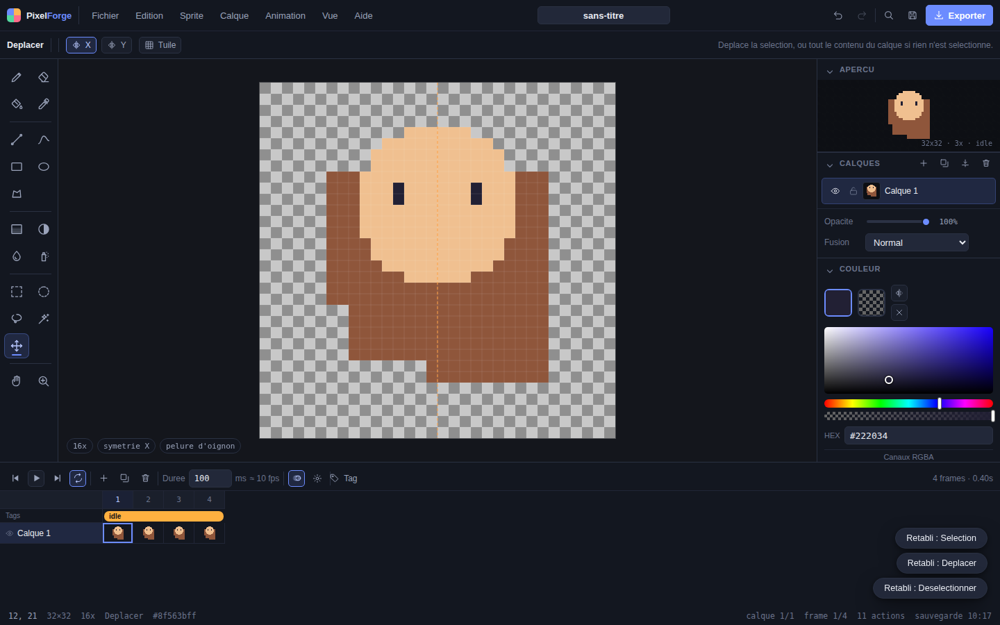
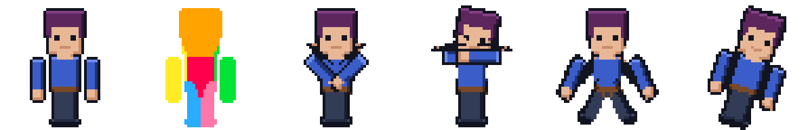
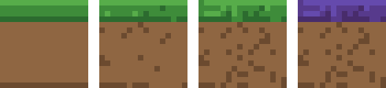
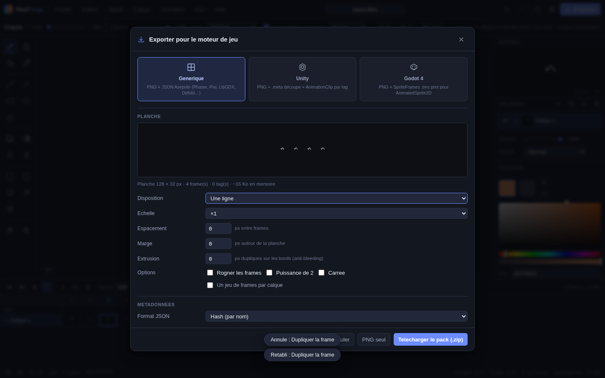
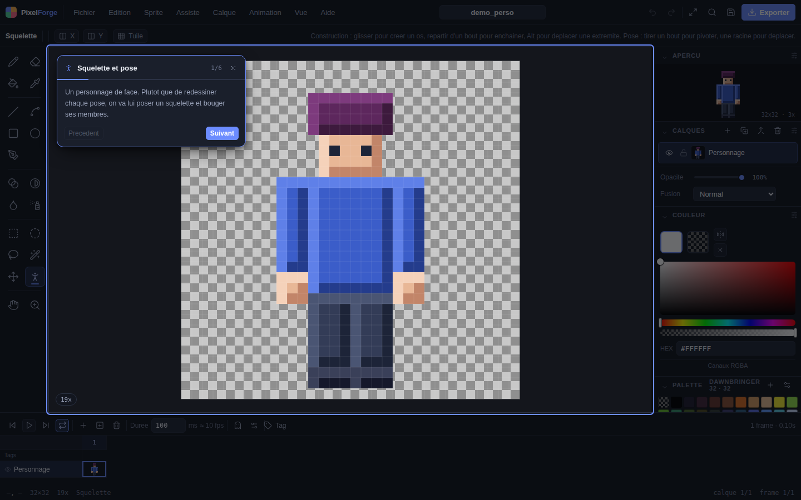
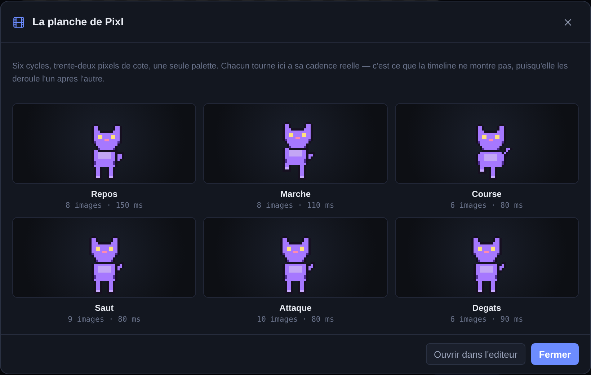
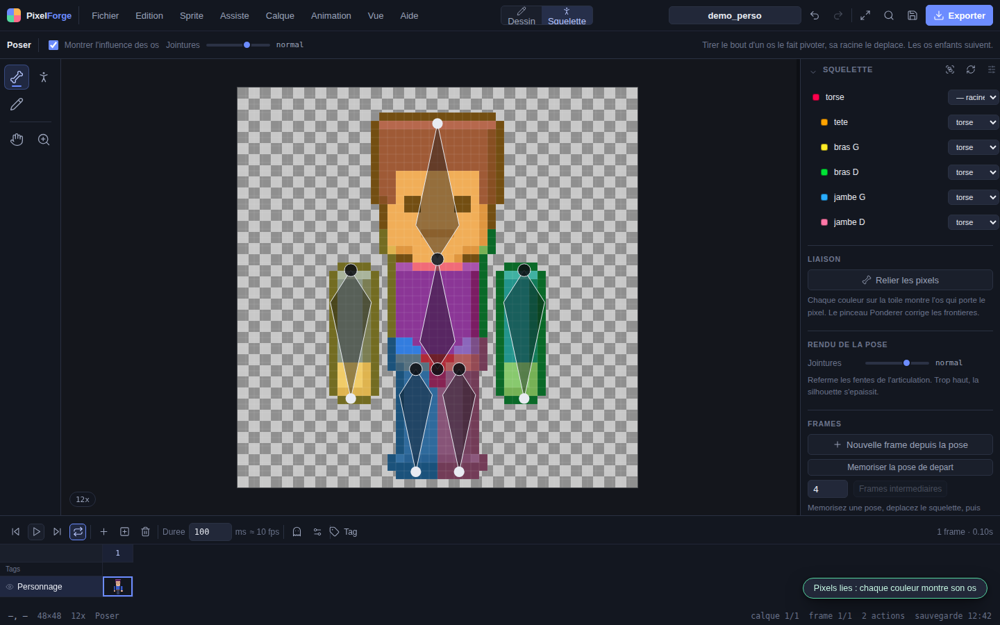

# PixelForge

Éditeur de sprites et d'animation pixel art dans le navigateur, pensé pour le
game dev. Dessin, timeline, tags d'animation, et surtout des exports qui
tombent directement dans un projet Unity ou Godot sans retouche.

Tout tourne côté client : aucun serveur, aucun compte, aucune donnée envoyée.
Les projets sont rangés dans le navigateur — plusieurs, nommés, avec leur
vignette — et `Ctrl+S` réécrit en plus un vrai fichier sur le disque quand le
navigateur le permet.



## Démarrer

```bash
npm install
npm run dev      # http://localhost:5173
```

```bash
npm run build    # génère dist/ (site statique, déployable tel quel)
npm run preview  # sert le build
```

## Déploiement

L'image finale ne contient que nginx et les fichiers construits : **21,5 Mo**,
dont 288 Ko de site. Ni Node, ni `node_modules`, ni sources. Elle tourne en
utilisateur non privilégié sur le port **8080**.

### Dokploy

Le `Dockerfile` et le `docker-compose.yml` sont à la racine, les deux types
d'application fonctionnent.

**Application (le plus court)**

1. **Create Application** → source **GitHub**, ce dépôt, branche `main`.
2. Build Type : **Dockerfile** (détecté tout seul).
3. **Port : `8080`** — l'image n'écoute pas sur 80, c'est ce qui lui permet
   de tourner sans droits root.
4. **Domains** → domaine + HTTPS → **Deploy**.

**Docker Compose**

Pointer sur `docker-compose.yml`, puis onglet **Domains** : Host = votre
domaine, Service = `pixelforge`, Container Port = `8080`.

Ce fichier ne publie **aucun port sur l'hôte** : Traefik joint le conteneur
par le réseau interne `dokploy-network`. C'est ce que Dokploy attend, et cela
évite le conflit `port is already allocated` si un autre service occupe déjà
le port sur la machine.

Aucune variable d'environnement n'est requise : l'application est entièrement
statique et ne parle à aucun service.

### Docker, sans Dokploy

Le second fichier publie le port sur l'hôte :

```bash
docker compose -f docker-compose.local.yml up -d --build   # http://localhost:8080
PIXELFORGE_PORT=8090 docker compose -f docker-compose.local.yml up -d   # autre port
```

```bash
# ou sans compose
docker build -t pixelforge .
docker run -d -p 8080:8080 --name pixelforge pixelforge
```

Les deux fichiers appliquent le même durcissement, vérifié au lancement :
système de fichiers en lecture seule, `cap_drop: ALL`, `no-new-privileges`,
et les fichiers temporaires de nginx en mémoire.

### Ce que fait l'image

- **Construction en deux étapes** : Node compile puis disparaît. Les
  dépendances sont dans une couche distincte du code, donc un changement de
  source ne réinstalle rien.
- **Le typage est vérifié pendant le build** : une erreur casse l'image au
  lieu d'arriver en production.
- **Compression au build** : les fichiers sont pré-compressés en gzip et
  servis tels quels via `gzip_static`. Le bundle passe de 180 Ko à 58 Ko sans
  aucun travail à chaque requête.
- **Cache** : les assets ont un nom haché, donc `immutable` pendant un an ;
  `index.html` est en `no-cache`, ce qui évite qu'un déploiement laisse des
  navigateurs sur l'ancienne version.
- **En-têtes** : CSP stricte (`default-src 'self'` — `blob:` et `data:`
  restent autorisés pour les exports), `nosniff`, `no-referrer`,
  `frame-ancestors 'none'`. Aucune origine externe n'est autorisée : la page
  ne charge rien qu'elle ne serve elle-même.
- **Sonde `/healthz`** utilisée par le `HEALTHCHECK` du conteneur et
  exploitable par l'orchestrateur.

### Hébergement statique

`npm run build` produit un `dist/` autonome en chemins relatifs : il se dépose
tel quel sur Netlify, Vercel, GitHub Pages, Cloudflare Pages ou un simple
bucket, sans configuration.

## Ce qu'on peut faire

### Dessiner

21 outils : crayon, gomme, pot de peinture, pipette, ligne, courbe de Bézier,
rectangle, ellipse, contour libre, **texte**, dégradé, ombrage, flou,
aérographe, les quatre modes de sélection (rectangle, ellipse, lasso, baguette
magique), déplacement, main et loupe.

- **Pixel perfect** : le filtre anti-coins d'Aseprite, actif par défaut sur les
  traits de 1 px.
- **Brosses** ronde, carrée, losange et lignes, de 1 à 64 px.
- **Modes de pose** : normal, derrière, alpha verrouillé.
- **Tramage** : Bayer 2/4/8, damier, lignes, bruit, avec ratio réglable — le
  dégradé peut lui aussi être tramé plutôt qu'interpolé.
- **Symétrie** X et Y en direct, **mode tuile** où le trait se replie sur les
  bords opposés (avec aperçu 3×3 pour vérifier le raccord).
- **Ombrage** : éclaircit au clic gauche, assombrit au clic droit, et
  réaligne le résultat sur la palette du sprite.
- 19 modes de fusion de calque, opacité par calque et par case.

#### Le texte — <kbd>T</kbd>

Deux fontes **dessinées pixel par pixel**, jamais une police du système. Une
police du système donne du texte anticrénelé — des gris sur les bords — dans un
dessin où chaque pixel est une couleur choisie ; et elle n'est pas la même
partout, donc un texte cadré au pixel près chez soi déborde chez quelqu'un
d'autre.

- **5×7** : deux casses, chiffres, ponctuation, et **tous les accents
  français**, capitales comprises. C'est la fonte par défaut.
- **3×5** : capitales seulement, pour les jauges et les étiquettes. Le `M` et
  le `W` y prennent **cinq** colonnes, le `I` et le `1` une seule : en trois
  colonnes, un `M` n'est qu'un `H` dont la barre a changé de rangée, et
  « MAMAN » se lit « HAHAN » — constaté à l'œil avant d'élargir la lettre.
  Les accents y **tombent** (`É` → `E`) : cinq rangées ne laissent pas la
  place d'un accent détaché, et un accent collé à la lettre fait une tache
  qu'on ne relit pas.

On clique, on tape, on relit — le texte reste **en attente** au-dessus du
dessin — puis <kbd>Ctrl</kbd>+<kbd>Entrée</kbd> le grave en **un seul geste**
d'historique. <kbd>Échap</kbd> l'abandonne ; <kbd>Entrée</kbd> saute une ligne ;
on tire la boîte pour la déplacer, et les flèches déplacent le curseur de
frappe. Changer d'outil **grave** au lieu d'abandonner : le texte en attente
n'existe nulle part ailleurs, et le perdre parce qu'on a pris la pipette pour
vérifier une couleur serait une perte sèche.

L'échelle (×1 à ×8) **duplique** les pixels — le seul agrandissement permis
ici. Ce qui déborde de la toile s'affiche en **fantôme** : la gravure s'arrête
au cadre, et sans ce signal on voit un titre entier pour n'obtenir que trois
lettres.

Un caractère absent de la fonte sort en **rectangle plein**. Le rendre en blanc
se lirait presque normalement, et l'on garderait son dessin sans voir que la
moitié d'un mot manque.

#### Les images de référence

**Glissez l'image dans la fenêtre** : sur un dessin en cours, elle se pose
aussitôt comme référence, sous le dessin, à 50 %. Sinon, le panneau
**Références** (colonne de droite) et le menu **Calque → Image de référence…**
font la même chose. Ce geste ouvrait l'image *à la place* du dessin — le
travail en cours disparaissait de l'écran pour laisser la photo. Sur un
document vierge il l'ouvre toujours, parce qu'il n'y a rien à perdre et que
c'est le « j'ouvre ce PNG pour le retoucher ».

**Le dessin gagne toujours sur l'image.** Le crayon écrit par-dessus, même en
plein milieu de la référence : le corps de l'image ne se saisit qu'avec l'outil
**Déplacer** (<kbd>V</kbd>), comme un calque ailleurs. Avant, une photo posée
sur toute la toile rendait le crayon inutilisable — on déplaçait le modèle en
croyant tracer un trait. Ses poignées, elles, restent saisissables avec
n'importe quel outil : elles sont sur le cadre, et c'est la seule chose qui
désigne la référence à l'œil.

**On la manipule comme dans Blender** : <kbd>G</kbd> déplacer, <kbd>R</kbd>
tourner, <kbd>S</kbd> dimensionner. On n'attrape rien — on appuie sur la
touche, on bouge la souris sans tenir de bouton, on clique pour poser.
<kbd>X</kbd> et <kbd>Y</kbd> contraignent l'axe (une ligne rouge ou verte le
dit), <kbd>Ctrl</kbd> pose par crans, <kbd>Maj</kbd> ralentit, et les chiffres
tapés donnent la valeur exacte : `G X 12 ↵` déplace de douze pixels vers la
droite, `R 45 ↵` tourne de quarante-cinq degrés. <kbd>Échap</kbd> remet tout
comme avant — un geste raté n'est pas une annulation à faire après coup, c'est
un geste qui n'a pas eu lieu. <kbd>Alt</kbd>+<kbd>G</kbd> recentre,
<kbd>Alt</kbd>+<kbd>R</kbd> redresse, <kbd>Alt</kbd>+<kbd>S</kbd> rend la taille
réelle.

Ce détour par le clavier n'est pas un caprice de puriste : **c'est ce qui sépare
vraiment la référence du dessin**. Puisque le bouton de la souris ne sert jamais
à l'attraper, elle ne peut plus voler un clic au crayon ; il n'y a plus de
poignée à viser, donc on déplace une image entièrement sortie du cadre ; et le
geste s'abandonne sans laisser de trace.

La souris reste possible pour qui préfère : on la **déplace** en la tirant (avec
l'outil **Déplacer**, <kbd>V</kbd> — c'est notre mode objet, et un clic y choisit
l'image comme on clique un objet dans Blender), on la **dimensionne** par ses
huit poignées — les coins gardent les proportions, <kbd>Maj</kbd> les libère,
<kbd>Alt</kbd> dimensionne depuis le centre — et on la **tourne** par la poignée
ronde au-dessus du bord haut.

- **Aimantation** : les bords et le centre de l'image se collent à ceux du
  cadre, avec une ligne de rappel rose qui dit à quoi — <kbd>Ctrl</kbd> la
  coupe. Centrer une référence à la main revenait à viser un demi-pixel.
- **Mesure en direct** pendant le geste : la position, la taille ou l'angle
  s'affichent sous la boîte, et restent dans la vue même quand l'image en sort.
- **Champs numériques** : X, Y, largeur, hauteur, angle, opacité. La souris
  pour chercher, les nombres pour retrouver — aligner deux références ou revenir
  à un angle rond ne se vise pas à la main.
- **Cadrages** : *Contenir* (l'image entière tient), *Remplir* (le cadre est
  couvert), *1:1* (un pixel de l'image pour un pixel du sprite), *Centrer*.
- **Miroirs** horizontal et vertical : un profil sert à dessiner les deux.
- Les **flèches** la déplacent au pixel quand sa ligne a le focus, <kbd>Maj</kbd>
  par dix. <kbd>Échap</kbd> la lâche — tant qu'une référence est choisie, le
  glisser la déplace au lieu de dessiner, il faut donc une façon évidente de
  rendre la vue au crayon.

Tout cela **s'annule**. Ce n'était pas le cas au début, et le défaut se cachait
bien : le panneau passait par l'historique, mais l'instantané de structure ne
photographiait pas les références — poser une image puis faire <kbd>Ctrl</kbd>+<kbd>Z</kbd>
ne la retirait pas, et une image tirée de travers ne se rattrapait plus. Un
geste entier fait **une** entrée d'historique, posée au relâchement.

Ce n'est **pas un calque**, et c'est tout l'intérêt. Une première version en
faisait un : l'image était réduite à la taille du sprite, gravée dans un
bitmap, posée là. Autant dire détruite — une photo de quatre cents pixels de
large ramenée dans un cadre de trente-deux ne montre plus rien — et surtout
elle ne bougeait plus. Une référence garde donc sa **définition d'origine** :
au zoom huit on voit la photo en grand, pas huit fois le même gros pixel. Elle
déborde librement du cadre, puisqu'on cadre le morceau qui intéresse.

Elle ne se peint pas — il n'y a rien à peindre, ce ne sont pas des pixels du
sprite — et elle ne s'exporte pas : ni dans le PNG, ni dans la planche, ni dans
le JSON. Elle part dans le fichier de projet, en revanche : on rouvre son
dessin avec le modèle qui l'explique, angle et miroirs compris.

C'est le seul endroit de l'éditeur où l'interpolation est permise. Une
référence n'est pas du dessin, et une photo réduite au plus proche voisin
devient illisible.

### Animer

- Timeline calques × frames avec vignettes, durée par frame, réordonnancement.
- **Tags d'animation** (`idle`, `run`, `hit`…) avec sens de lecture avant,
  arrière, aller-retour, et nombre de répétitions.
- **Pelure d'oignon** jusqu'à 3 frames avant et après, teintées rouge/bleu.
- Lecture en direct sur la toile, limitée au tag courant si besoin.

### Effets de calque

Les effets se posent sur un **calque**, pas sur des pixels : ils sont
recalculés au moment de composer l'image. On règle donc une ombre en la
regardant bouger, on la coupe d'un clic, on revient en arrière sans perte —
et le dessin d'origine reste intact sur toutes les frames.

Huit effets : **ombre portée**, **ombre interne**, **lueur externe**,
**lueur interne**, **contour**, **biseau**, **teinte**, **dégradé**. La
section EFFETS du panneau Calques les liste ; le menu Calque les pose aussi
d'un coup.

Un point les sépare de leurs équivalents en maquette : **il n'y a pas de
flou gaussien**. Un flou fabriquerait des centaines de couleurs et casserait
le pixel art. L'atténuation se règle sur trois positions :

| Bord | Ce qu'il fait | Couleurs ajoutées |
| --- | --- | --- |
| **Net** | l'effet s'arrête franchement | 1 |
| **Paliers** | 2 à 6 niveaux d'opacité | autant que de paliers |
| **Trame** | un motif de Bayer régulier remplace le dégradé | 1 |

La distance au bord est mesurée par une transformée exacte, pas approchée :
une lueur tramée dessine de vrais anneaux ronds, pas des losanges.

Le **retrait** existe pour les dessins déjà cernés d'un contour sombre : il
fait démarrer un biseau ou une lueur interne quelques pixels plus loin, sur
la matière, au lieu de délaver le trait.

Les effets partent tels quels dans la planche, le GIF et les exports moteur.
`Calque > Graver les effets` les inscrit dans les pixels quand on veut les
retoucher à la main.

### Travailler avec l'assistant

Trois fonctions s'appuient sur une analyse du dessin plutôt que sur des
réglages aveugles. Les couleurs du sprite sont d'abord regroupées en
**familles** — les teintes d'une même gamme classées de l'ombre à la
lumière. C'est l'unité de travail naturelle du pixel art : un vêtement, une
peau, un feuillage sont chacun une famille.



*De gauche à droite : le dessin de repos, la carte des os — une couleur par
os, qui montre à qui appartient chaque pixel — puis quatre poses.*

#### Tourner en 3D — `Ctrl+Maj+R`

Le squelette fait pivoter des membres **dans le plan du dessin**. Il ne sait
pas montrer un trois-quarts : pour cela il faudrait savoir ce qu'il y a
derrière, et un dessin plat ne le dit pas.

On le devine. Chaque pixel reçoit une **épaisseur**, lue dans la silhouette :
loin du bord, la matière est épaisse ; sur le contour, elle est mince. Le
dessin cesse d'être une image et devient un volume dont il est la tranche du
milieu. Tourner revient alors à faire tourner ce volume et à le reprojeter —
les occultations tombent juste, sans qu'aucun modèle 3D n'existe.

Trois angles (lacet, tangage, roulis) et deux réglages de relief (hauteur,
galbe). Le résultat s'applique sur place ou part sur sa propre frame.

**Rien n'est interpolé** : les pixels sont déplacés, jamais mélangés. La
palette traverse la transformation intacte, et `npm run test:rotation` le
mesure à chaque degré plutôt que de le supposer — avec la masse, la
continuité et l'étanchéité de la silhouette.

Ce que ce n'est pas : un vrai dos. Au-delà d'un demi-tour le résultat est une
base à reprendre au crayon, pas une vue juste. Le dialogue le dit, et prévient
dès qu'une pose perd de la matière ou se perce.

**Squelette et pose** (`Maj+K`). Six modèles prêts à l'emploi — humanoïde de face
et de profil, quadrupède, oiseau, arbre, membre simple — se calent sur la
boîte des pixels opaques, donc ils tombent juste quelle que soit la taille du
sprite. On peut aussi tracer les os soi-même.

Un personnage se rigge d'autant mieux que ses membres se distinguent du
corps : le personnage de démonstration écarte les bras du torse de trois
pixels, ce qui laisse une colonne libre entre les deux contours. La liaison
sépare alors le bras du corps au lieu de couper au milieu d'une masse
continue. On lie ensuite les
pixels : chacun est attribué à l'os le plus proche. Tirer une
extrémité fait pivoter le membre et l'image est régénérée : le parcours va
du pixel d'arrivée vers sa source, donc aucun trou n'apparaît là où la
matière s'étire, et les fissures d'articulation sont refermées par une
recherche locale puis un comblement majoritaire. Les os s'enchaînent — une
rotation d'épaule entraîne tout le bras — et les pixels qu'aucun os ne porte
restent en place, ce qui permet de ne rigger qu'une partie du dessin.
Mémorisez une pose, déplacez le squelette, et les frames intermédiaires sont
générées par interpolation.

**Variantes de couleur** (`Ctrl+Maj+V`). On choisit une famille et l'éditeur
en propose des déclinaisons : tour du cercle chromatique, teintes voisines,
complémentaire, ou strictement dans la palette du projet. Les rapports
d'ombre et de lumière sont conservés, donc le modelé survit au changement de
teinte. Les variantes retenues deviennent des frames taguées, des calques,
ou remplacent le sprite.



**Ajouter du détail** (`Ctrl+Maj+D`). Grain, taches, touffes, ombre des
bords, lumière du haut, volume tramé — avec des enchaînements prêts pour
l'herbe, la pierre, la terre, le tissu et le métal. Chaque pixel se décale
d'un cran dans sa propre famille, si bien que la texture **n'introduit
aucune couleur étrangère**. Une graine fait varier le tirage, et « Ajouter »
fige la passe courante pour en préparer une autre : le détail se cumule.

### Exporter

La fenêtre d'export montre la planche générée en direct et produit une archive
prête à déposer dans le projet.



| Cible | Contenu de l'archive |
|---|---|
| **Générique** | `sprite.png` + `sprite.json` au format Aseprite (lu tel quel par Phaser, PixiJS, LibGDX, Defold, MonoGame…) |
| **Unity** | `sprite.png` + `sprite.png.meta` (découpe, pivot, filtre Point, sans compression) + un `.anim` par tag + le JSON |
| **Godot 4** | `sprite.png` + `sprite_frames.tres` (SpriteFrames avec une AtlasTexture par frame, prêt pour `AnimatedSprite2D`) + le JSON, et un `TileSet` en option |

Dispositions de planche : une ligne, une colonne, grille à N colonnes, une
ligne par tag, ou empaquetage compact. Avec **extrusion** des bords
(anti-bleeding en filtrage bilinéaire), espacement, marge, rognage par frame,
contrainte puissance de deux et carré, et agrandissement entier ×1 à ×8.

Autres sorties : PNG de la frame, PNG de chaque frame en `.zip`, **GIF animé**
(encodeur écrit pour le projet, durées et transparence conservées), palette
`.gpl`, et le projet `.pixelforge` rechargeable sans perte.

Quelques détails qui comptent à l'import :

- Unity attend une origine en bas à gauche : les rectangles du `.meta` sont
  inversés en Y, et les identifiants internes sont stables d'un export à
  l'autre, donc les références des `.anim` ne cassent pas.
- Une zone 9-slice définit la propriété *Border* du sprite Unity.
- Godot exprime la vitesse en images par seconde plus un multiplicateur par
  frame : la frame la plus courte sert de référence, ce qui reproduit
  exactement les durées d'origine.

### Importer

Glisser une image ou un `.pixelforge` sur la zone de dessin, ou coller une
image depuis le presse-papiers. Une planche existante peut être redécoupée en
frames en indiquant la taille des cases, l'espacement et la marge.

### Palettes

11 palettes intégrées (DawnBringer 32, PICO-8, Sweetie 16, Endesga 32, Vinik
24, Game Boy, NES, CGA…), extraction par median cut depuis le sprite, import
`.gpl` et `.hex` (Lospec), tri par luminosité ou par teinte. Remplacer une
couleur de la palette la remplace dans tout le sprite.

#### Les groupes : « herbe », « peau », « métal »

Trente-deux pastilles alignées ne disent rien de ce qu'elles sont. Le pixel art
travaille par **familles**, et chaque famille est une rampe qu'on parcourt de
l'ombre à la lumière — c'est l'unité de travail réelle, et elle n'existait
nulle part : ni à l'œil, ni pour les outils.

Sous le nuancier, on crée un groupe, on lui donne un nom, et l'on y **glisse
les pastilles**. Un groupe reste trié de l'ombre à la lumière, parce qu'un
groupe *est* une rampe. Une couleur n'appartient qu'à un seul groupe : sinon
les outils choisiraient au hasard lequel des deux fait foi. Défaire un groupe
ne jette rien — on range, on ne supprime pas.

**Deviner** remplit les groupes d'un clic : le moteur sait déjà regrouper les
couleurs d'un sprite par teinte, autant le proposer plutôt que de faire ranger
trente pastilles à la main. On corrige ensuite ce qu'il a mal rangé.

Et surtout : **un groupe déclaré fait foi** pour l'ombrage et pour le détail.
Deviner range par teinte — le vert d'un feuillage et le vert d'un pantalon
tombent dans la même famille, et l'ombre de l'un se met à puiser dans l'autre.
Ce qui n'est dans aucun groupe garde la famille devinée : on ne punit pas celui
qui n'a rien rangé. Les groupes partent dans le fichier de projet ; un projet
enregistré avant qu'ils existent se relit sans en avoir.

## Enregistrer son travail

Trois rangements, du plus automatique au plus définitif.

### Mes projets — `Ctrl+Maj+L`

La bibliothèque du navigateur : plusieurs projets nommés, chacun avec sa
vignette, sa date et son poids. `Ctrl+S` y range le document courant, et
l'éditeur l'y réécrit tout seul toutes les minutes ainsi qu'à chaque fois que
l'onglet passe en arrière-plan. Au lancement suivant, il propose de reprendre
là où vous en étiez.

Un projet ouvert depuis la liste reste **rattaché à son entrée** : les
enregistrements suivants le mettent à jour au lieu d'empiler des copies.

Le rangement est **IndexedDB**, et c'est ce qui rend la chose utilisable. La
version précédente écrivait dans `localStorage`, à un seul emplacement et sous
un quota d'environ 5 Mo pour toute l'origine — mesuré. Un projet de jeu
ordinaire, 64×64 sur quatre calques et soixante images, en pèse près d'un :
au troisième, l'écriture échouait, et elle échouait **en silence**. Le banc
enregistre désormais ce projet-là et vérifie qu'il revient au pixel près.

Ce que ce n'est pas : un coffre-fort. Ces données vivent dans le navigateur de
la personne. Vider les données du site les efface, une fenêtre privée repart
de zéro, et un navigateur à court de place peut évincer une origine qui n'a
rien demandé. Le bouton **Garder durablement** demande au navigateur de s'en
abstenir (`navigator.storage.persist()`) ; un refus n'est pas une erreur, il
n'y a simplement rien de plus à faire. C'est pourquoi la liste dit franchement
où vivent ces fichiers, et met l'export sur disque à portée de main sur chaque
projet.

### Un vrai fichier — `Ctrl+Maj+S`

*Enregistrer sous…* ouvre le sélecteur du système. Une fois le fichier choisi,
`Ctrl+S` le **réécrit en silence**, comme une application de bureau : plus de
`heros (7).pixelforge` dans le dossier des téléchargements. Le fichier est
retenu d'une session à l'autre ; le navigateur redemande simplement
l'autorisation d'écrire au premier enregistrement de chaque session, et aucune
page ne peut s'en dispenser.

Cela repose sur l'API File System Access, que **Chrome et Edge** ont et que
**Firefox et Safari** n'ont pas. Là où elle manque, *Enregistrer sous…*
télécharge une copie — le comportement de tout le monde jusqu'ici, pas un mode
dégradé.

### Exporter

Pour un moteur de jeu, c'est `Ctrl+E` : planche, GIF, Unity, Godot. Voir
[Exporter](#exporter).

## Apprendre

`Maj+F1` ouvre les tutoriels, et la visite est proposée au tout premier
lancement. Chaque leçon charge un document de démonstration et se déroule
**dans l'éditeur** : la zone concernée est mise en avant, l'étape se valide
d'elle-même dès que le geste est fait, et un bouton l'exécute à votre place
si vous préférez voir le résultat d'abord.



Six leçons : prise en main, animer, squelette et pose, détail et variantes,
effets de calque, export vers un moteur.

La leçon du squelette ne fait rien à votre place : elle attend que vous
basculiez de mode, que vous posiez le modèle, que vous liiez les pixels et
que vous tiriez le bras — une flèche animée sur la toile montre exactement
le geste à faire.

## Pixl



La mascotte de PixelForge est un chat de 32×32 pixels, avec six cycles
d'animation faits image par image : repos, marche, course, saut, attaque,
dégâts. Elle a été dessinée dans l'éditeur, et c'est le seul argument qui
compte pour un logiciel de sprites.

Elle n'est donc pas rangée dans une démo : elle tient le logo et l'icône de
l'onglet, elle accueille au premier lancement, elle accompagne les leçons —
elle saute quand une étape est réussie, elle fait les cent pas quand on
cherche — et elle occupe les endroits où il n'y a rien à montrer, comme une
recherche sans résultat.

Deux règles la tiennent à sa place : elle ne bouge jamais toute seule dans un
coin permanent de l'écran, et elle quitte la zone de dessin dès le premier
trait. Quand le système demande de limiter les animations
(`prefers-reduced-motion`), elle garde une pose fixe.

`Fichier ▸ Ouvrir la mascotte animée` la charge dans l'éditeur avec ses six
tags déjà posés. Et quelqu'un qui s'obstine sur le logo finira par la voir
faire autre chose.

## Deux modes de travail

L'éditeur bascule entre **Dessin** et **Squelette** depuis la barre du haut,
et l'interface entière suit : barre d'outils, panneaux, réglages. On ne
cherche pas un crayon quand on articule un personnage.



En mode Squelette, trois outils : **Créer des os**, **Poser** et
**Pondérer**. Chaque couleur sur la toile montre l'os qui porte le pixel —
la lecture la plus directe de ce qui va bouger avec quoi — et le pinceau
Pondérer corrige les frontières quand un bout d'épaule part avec le bras.
Les couleurs suivent le membre quand il bouge : elles sont recalculées dans
l'espace de la pose, pas du repos.

Chaque mode garde sa propre disposition de panneaux.

## Espace de travail

Les panneaux ne sont pas figés. Chacun se déplace entre le dock gauche et le
dock droit par glisser-déposer sur son en-tête, se réordonne, se plie ou se
masque ; les docks se redimensionnent au séparateur et la timeline s'affiche
ou se cache. Cinq dispositions couvrent les façons de travailler courantes —
complet, dessin, animation, deux colonnes, minimal — et la disposition
courante est restaurée au chargement suivant.

## Raccourcis

`F1` affiche la liste complète, `Ctrl+K` ouvre la palette de commandes.

| | |
|---|---|
| Outils | `B` crayon · `E` gomme · `G` pot · `I` pipette · `L` ligne · `U` rectangle · `Maj+U` ellipse · `Q` contour · `T` texte · `R` dégradé · `D` ombrage · `M` sélection · `W` baguette · `V` déplacer · `Z` loupe |
| Pinceau | `[` `]` taille · **Alt + molette** sur la toile · le curseur de la barre d'options se tire jusqu'au bout |
| Aperçus des dialogues | molette : zoom · glisser : déplacer · double-clic : ajuster |
| Souris | clic droit = couleur secondaire · `Alt`+clic = pipette · `Espace`+glisser = déplacer la vue · molette = zoom |
| Pendant un tracé | `Maj` contraint à 45° · `Alt` dessine depuis le centre |
| Sélection | `Maj` ajoute · `Alt` soustrait · `Ctrl` intersecte · flèches déplacent les pixels |
| Animation | `,` `.` frame précédente/suivante · `Entrée` lecture · `Alt+N` nouvelle frame · `Ctrl+T` tag |
| Assistant | `Maj+K` mode squelette · `Ctrl+Maj+V` variantes · `Ctrl+Maj+D` détail |
| Mode squelette | `K` créer des os · `J` poser · `N` pondérer |
| Aide | `Maj+F1` tutoriels · `F1` raccourcis · `Ctrl+K` commandes |
| Références | `G` déplacer · `R` tourner · `S` dimensionner, puis clic pour poser ou `Échap` pour annuler · `X` `Y` contraignent l'axe · chiffres tapés = valeur exacte · `Alt+G` recentre, `Alt+R` redresse, `Alt+S` taille réelle · `V` puis clic : choisir l'image · flèches : au pixel · `Échap` la lâche |
| Texte | `T` outil · `Entrée` nouvelle ligne · `Ctrl+Entrée` grave · `Échap` abandonne · flèches : curseur de frappe |
| Divers | `X` permute les couleurs · `[` `]` taille de brosse · `Échap` annule le geste puis désélectionne |

## Sous le capot

Aucune dépendance à l'exécution : TypeScript strict et l'API Canvas.

```
src/
  core/        modèle et état
    bitmap      surface RGBA, vue Uint32 pour les opérations en masse
    color       couleurs packées, HSV, distance perceptuelle
    blend       19 modes de fusion (spécification W3C, comme Aseprite)
    document    Sprite / Layer / Cel / Tag / Slice
    selection   masque binaire, combinaisons, contour des fourmis marcheuses
    history     annulation par diff de région, snapshots de structure
    operations  transformations, presse-papiers, effets
    editor      état central et point d'entrée des mutations
  tools/       algorithmes (Bresenham, ellipse, remplissage par lignes,
               pixel perfect, tramage) et les 20 outils
  render/      composition des calques et viewport (zoom, grilles, onion skin)
  export/      planches, JSON, Unity, Godot, GIF, ZIP
  smart/       analyse des familles de couleurs, variantes, détail, squelette
  io/          sauvegarde du projet et import d'images
  ui/          panneaux, menus, dialogues, raccourcis
docker/        configuration nginx de l'image de production
```

Deux choix structurants :

- **Les cases occupent toute la toile.** Les outils, la sélection et les
  transformations n'ont donc jamais à gérer d'offset. La mémoire reste
  raisonnable en pixel art, et la sérialisation passe les pixels en PNG.
- **L'historique stocke des différences de région.** Un trait n'enregistre que
  le rectangle réellement modifié ; les opérations de structure prennent un
  instantané qui partage les bitmaps par référence, donc quasi gratuit.

## Tests

```bash
npm run typecheck
npm run test          # tous les bancs
npm run test:smoke    # nécessite Chromium : npx playwright install chromium
npm run test:rotation # géométrie de la rotation par relief
npm run test:detail    # ce que « Ajouter du détail » fait d'un aplat
npm run test:palette   # les groupes de palette, et ce qu'ils imposent aux outils
npm run test:reference # les images de référence : poignées, proportions, export
npm run test:zoom      # la molette, sur un grand sprite
npm run test:texte     # les fontes pixel, et la frappe qui ne pilote pas l'éditeur
```

Le banc du **zoom** travaille sur un sprite de 512 — pas par goût des grands
nombres : c'est la seule taille qui révélait le défaut. Le zoom multipliait par
1,15 puis arrondissait à l'entier au-dessus de 1×, et `1 × 1,15 = 1,15`
s'arrondit à 1. La molette ne sortait donc jamais de 1×, ni de 2×, ni de 3×.
Sur un sprite de 32, qui s'ouvre à 20×, le défaut était invisible.

Le banc du **détail** garde les deux bouts d'une même règle : la teinte se
fabrique quand la rampe n'en a pas — sans cela l'outil ne faisait rien du tout
sur une forme peinte d'un seul ton, ce qui est justement le moment où l'on
demande du détail — et elle ne se fabrique **pas** quand le dessin a déjà sa
rampe. Le second point est le plus important : sans lui, l'outil se mettrait à
inventer des couleurs dans un sprite qui avait sa palette, et la cohérence
promise ne serait plus qu'un commentaire.

Le banc des **références** tape vraiment `G X 12 ↵` dans la fenêtre, et vérifie
que l'image bouge de douze pixels sur X et de rien sur Y ; que <kbd>Échap</kbd>
la remet exactement où elle était sans rien laisser dans l'historique ; et que
sans référence choisie, `G` reste le pot de peinture — une touche empruntée doit
être rendue. Il tient aussi la géométrie de la manipulation : qu'un point
fasse l'aller-retour exact dans le repère de l'image tournée — tout le reste en
dépend, poignées comprises — que tirer un bord d'une image de travers la
dimensionne le long de *son* axe sans faire bouger le bord opposé d'un pixel,
que l'aimantation colle ce qu'il faut et rien d'autre, et que poser, déplacer
et retirer une référence s'annulent. Ce dernier point est celui qui manquait :
il ne se voyait qu'en faisant <kbd>Ctrl</kbd>+<kbd>Z</kbd> après avoir posé une
image, et en la voyant rester.

Le banc du **texte** tape un mot dans la vraie fenêtre. C'est là qu'est le
piège : dans cet éditeur chaque lettre est déjà le raccourci d'un outil — `b`
le crayon, `e` la gomme, `j` la pose du squelette — donc un outil de texte qui
ne retient pas la frappe est pire qu'absent, « bonjour » pilote l'éditeur au
lieu de s'écrire. Il vérifie aussi ce qu'un programme peut juger d'une fonte,
faute de pouvoir dire qu'un `M` est laid : qu'aucune lettre, aucun chiffre,
aucun signe ne manque, que tous les glyphes ont la hauteur de la fonte, que
rien ne sort de la boîte annoncée, et qu'un `×3` donne exactement neuf fois
plus de pixels — un seul pixel interpolé et le texte n'appartient plus au
dessin.

Le banc des **groupes de palette** vérifie qu'une couleur n'est que dans un
groupe, qu'un groupe reste trié de l'ombre à la lumière, qu'un groupe déclaré
prime sur la famille devinée *pour ses couleurs seulement*, et que l'aller-retour
par le fichier de projet les rend intacts.

Le test de bout en bout ouvre l'application dans un vrai navigateur et vérifie
le dessin, l'historique, les cinq dispositions de planche (aucun chevauchement,
pixels identiques aux frames source), l'extrusion, le JSON, le `.meta` Unity et
son inversion en Y, les `AnimationClip`, la ressource Godot, le GIF relu par le
décodeur du navigateur, la signature du ZIP et l'aller-retour du projet.

Le banc de rotation balaie le lacet **degré par degré**, de −75° à +75°, sur
quatre sujets choisis pour leurs pièges : la mascotte, un disque (le relief le
plus haut), une lame (longue et fine) et un anneau (un vrai trou, qu'aucun
bouchage ne doit combler). À chaque angle il exige que le dessin ressorte
intact à 0°, que la masse tienne jusqu'à 45° et ne descende jamais sous celle
d'une feuille de papier au-delà, qu'aucune couleur étrangère n'apparaisse, que
la silhouette ne se perce pas, que deux angles voisins ne sautent pas de plus
d'une colonne, et que les deux profils se vaillent.

Chaque règle a été vérifiée **en la cassant** : revenir à une coque au lieu
d'un volume plein fait tomber quatorze vérifications, interpoler une couleur
en fait tomber huit. Un banc qui ne sait pas échouer ne protège rien.

## Limites connues

- Pas de groupes de calques ni de cases liées.
- Le squelette déforme au plus proche voisin : une rotation faible sur un
  petit sprite reste anguleuse, comme toute rotation de pixel art.
- Pas de lecture ni d'écriture du format `.aseprite` binaire ; l'échange passe
  par le PNG et le JSON.
- Le mode couleur est RGBA : pas d'indexé strict, mais l'alignement sur la
  palette permet de s'y contraindre.
- Les projets ne quittent pas la machine : pas de compte, donc pas de reprise
  sur un autre poste. C'est l'export sur disque qui les déplace.
- Deux onglets ouverts sur le même projet se marchent dessus : le dernier
  enregistrement gagne, sans fusion ni avertissement.
